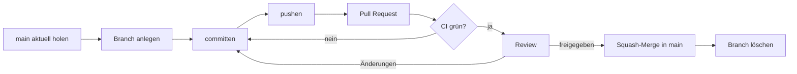
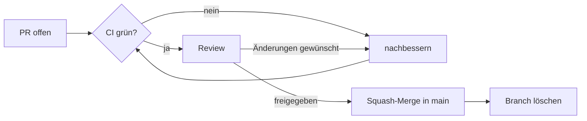

# Arbeiten in diesem Repository

Branches, Commits, Pull Requests, Reviews. Gilt für alle Module.

Wenn dir eine Regel unpraktisch erscheint, sprich sie an, statt sie zu umgehen.
Konventionen sind nur so viel wert, wie sich alle daran halten.

## Werkzeuge

Welche IDE oder welchen Editor du benutzt, ist deine Sache. Das Projekt baut
über die Kommandozeile, Formatierung regelt `.editorconfig`, und IDE-Ordner
stehen in `.gitignore`.

Was du brauchst und wie du deinen Rechner einrichtest, steht in
[`docs/entwicklungsumgebung.md`](docs/entwicklungsumgebung.md).

## Wo was liegt

| Wofür | Wo |
|---|---|
| User Stories, Aufgaben, Sprintplanung, Projektstand | **Jira** |
| Code, Reviews, Pull Requests, Build-Pipeline | **GitHub** |

Es gibt genau **einen** Tracker, und das ist Jira. GitHub Issues sind
abgeschaltet.

Verbunden werden beide Systeme über den **Jira-Key** (z. B. `AIP6-42`). Er gehört
in jeden Branch-Namen und jede Commit-Nachricht. Dadurch erscheint die Arbeit
automatisch im zugehörigen Ticket, und man erkennt in der Git-Historie noch
Monate später, zu welcher Story ein Commit gehörte.

## Branch-Modell

`main` ist immer baubar. Jede Änderung kommt über einen kurzlebigen Branch und
einen Pull Request hinein.



## Der Ablauf

### 1. Aktuellen Stand holen

```bash
git switch main
git pull
```

Immer zuerst. Ein Branch, der von einem alten Stand abzweigt, produziert
vermeidbare Konflikte.

### 2. Branch anlegen

```bash
git switch -c feat/AIP6-42-gang-schieben
```

Schema: `<typ>/<JIRA-KEY>-<kurzbeschreibung>`

| Typ | Wofür |
|---|---|
| `feat` | neue Funktionalität |
| `fix` | Fehlerbehebung |
| `docs` | nur Dokumentation |
| `test` | nur Tests |
| `refactor` | Umbau ohne Verhaltensänderung |
| `chore` | Build, Konfiguration, Werkzeuge |

Key groß, Kurzbeschreibung klein, Wörter mit Bindestrich, keine Umlaute.

**Branch aus Jira anlegen:** Im Ticket rechts unter *Development* gibt es
*Create branch*. Jira schlägt einen Namen aus Key und Ticket-Titel vor
(`AIP6-42-…`). Davor den Typ setzen und den Rest auf eine kurze Beschreibung
kürzen, ohne Umlaute: `feat/AIP6-42-gang-schieben`.

Gibt es noch kein Ticket, leg vorher eins an. Für Kleinkram ohne eigenes Ticket
(Tippfehler, Aufräumen im Build) darf der Key entfallen:
`chore/gitignore-aufraeumen`. Das bleibt die Ausnahme.

### 3. Arbeiten und committen

**Vor jedem Commit muss der lokale Build grün sein.** Was lokal nicht baut, baut
auch in der Pipeline nicht und blockiert dann alle anderen.

Commit-Nachrichten folgen **Conventional Commits** mit dem Jira-Key als Scope:

```
<typ>(<JIRA-KEY>): <was geändert wurde, klein, kein Punkt am Ende>
```

```
feat(AIP6-42): add push validation for fixed tiles
fix(AIP6-57): prevent two figures on the same field after push
docs(AIP6-13): describe bonus rules in pflichtenheft
chore: bump junit to 5.10.1
```

Sprache: **Englisch**. Alle Commits zu einer Story findest du später mit
`git log --grep=AIP6-42`.

Lieber mehrere kleine Commits mit klarer Aussage als ein großer Sammel-Commit.
Ein Commit sollte eine Sache tun.

### 4. Hochladen und Pull Request

```bash
git push -u origin feat/AIP6-42-gang-schieben
gh pr create
```

Das `-u` nur beim ersten Push eines Branches.

Der **PR-Titel folgt demselben Format wie eine Commit-Nachricht**:

```
feat(AIP6-42): validate tile push on server
```

Der Grund: Beim Squash-Merge wird der PR-Titel zum einzigen Commit, der auf
`main` landet. Die einzelnen Commits des Branches stehen nur noch klein
darunter. Hält sich der Titel nicht an das Format, hält sich `main` auch nicht
daran.

Den PR-Text gibt die Vorlage vor: kurz **was** geändert wurde und **warum**.
Das Ticket selbst wird in Jira geschlossen, nicht über GitHub.

Mit dem PR startet die CI-Pipeline.

### 5. Review und Merge



- Mindestens **eine Freigabe** durch jemand anderen.
- Zuständigkeiten stehen in `.github/CODEOWNERS` und werden automatisch
  angefragt.
- Niemand mergt seinen eigenen PR ohne fremde Freigabe.
- **Squash-Merge**: alle Commits des Branches werden zu einem zusammengefasst,
  benannt nach dem PR-Titel. `main` bleibt dadurch linear und lesbar — ein
  Commit pro abgeschlossener Aufgabe. Andere Merge-Arten sind abgeschaltet.
- Der Branch wird nach dem Merge automatisch gelöscht.

Ein Review ist kein Misstrauensvotum. Es ist die billigste Stelle, an der ein
Fehler noch auffallen kann.

## Code, Javadoc und Tests

Diese Regeln stehen im Pflichtenheft (NF-09, NF-13, 12.1, 12.4).

### Sprache

- **Englisch:** alle Namen im Code (Klassen, Methoden, Variablen, Tests),
  Javadoc, Commit-Nachrichten, PR-Titel.
- **Deutsch:** Texte in der Oberfläche und die Doku in `docs/`.
- Keine Platzhalter-Kommentare und keine Emojis im Code.

### Javadoc

Jede öffentliche Klasse und Methode hat Javadoc, mit `@param` für jeden
Parameter und `@return` für den Rückgabewert. Fehlt etwas, scheitert
`build`, lokal wie in der Pipeline.

```java
/**
 * Checks whether the given row can be moved by a push.
 *
 * @param row index of the row, starting at 0
 * @return {@code true} if the row index is odd
 */
public boolean isMovableRow(int row) {
    return row % 2 == 1;
}
```

- Der erste Satz ist die Kurzbeschreibung und endet mit einem Punkt.
- Keine Javadoc brauchen private und paketinterne Klassen und Methoden,
  Tests und Methoden mit `@Override` (sie erben die Beschreibung).
- Klassen, die JavaFX selbst erzeugt (`extends Application`), bekommen einen
  sichtbaren leeren Konstruktor mit Javadoc. Sonst meldet die Prüfung den
  unsichtbaren Standardkonstruktor.
- Setzt der Code eine bestimmte Anforderung oder Annahme um, darf ihre
  Kennung in der Javadoc stehen, z. B. `(A-01)`. Pflicht ist die Kennung nur
  in Tests (nächster Abschnitt).
- Ob die Javadoc englisch ist, prüft der Build nicht. Das gehört ins Review.

### Anforderungs-ID in Tests

Jeder Test, der eine Anforderung aus dem Pflichtenheft prüft, nennt ihre
Kennung (`F-…`, `NF-…` oder `V-…`), am besten per `@Tag`. So bleibt im
Testplan nachvollziehbar, welche Tests eine Anforderung abdecken.

```java
@Test
@Tag("F-237")
void recognizesHeadlessOption() {
    assertTrue(ServerApp.isHeadless(new String[] {"--headless"}));
}
```

Das Beispiel stammt aus `ServerAppTest` im Modul `server`. Ein Test darf
mehrere Tags tragen, etwa `@Tag("V-03")` für eine Prüfung aus dem
Prüfkatalog. Laut Pflichtenheft geht auch die Kennung im Testnamen; der Tag
ist eindeutiger und lässt sich beim Ausführen filtern.

### Definition of Done

Eine Aufgabe ist fertig, wenn der Code reviewt ist, Tests vorhanden und grün
sind, die Javadoc vollständig ist, die Pipeline grün ist und die
Anforderungs-ID im Ticket verknüpft ist. Dokumente prüft zusätzlich das
Qualitätsmanagement. Die Checkliste der PR-Vorlage fragt das ab.

## Was nicht erlaubt ist

- **Kein direkter Push auf `main`.** Der Branch ist geschützt; der Versuch
  schlägt fehl.
- **Kein `git push --force`** auf einen Branch, an dem jemand anderes arbeitet.
  Er überschreibt fremde Commits unwiederbringlich.
- **Keine Zugangsdaten im Repo.** Passwörter, Tokens und Schlüssel gehören in
  lokale Dateien, die in `.gitignore` stehen.
- **Keine Build-Ergebnisse oder IDE-Konfiguration committen.**
- **Keine Aufgabenverwaltung außerhalb von Jira.** Keine TODO-Listen in
  Markdown, keine Aufgaben in PR-Kommentaren, die nirgends landen.

## Lokale Git-Einstellungen

Identität — dieselbe E-Mail wie beim GitHub-Account, sonst werden deine Commits
nicht deinem Profil zugeordnet:

```bash
git config --global user.name "Dein Name"
git config --global user.email "deine@mail.at"
```

Zeilenenden — wir sind ein gemischtes Windows/macOS-Team:

```bash
# Windows
git config --global core.autocrlf true

# macOS / Linux
git config --global core.autocrlf input
```

Die `.gitattributes` im Repo erzwingt LF in der Historie; die lokale Einstellung
ist die zweite Sicherung. Ohne beides sehen Pull Requests so aus, als wären
hunderte Zeilen geändert, obwohl nur ein Wort getauscht wurde.

## Wenn etwas klemmt

**`not a git repository`** — du stehst außerhalb des Projektordners.

**Push abgelehnt: „protected branch"** — du versuchst, direkt auf `main` zu
pushen. Das ist Absicht. Leg einen Branch an.

**PR zeigt hunderte geänderte Zeilen, obwohl du kaum etwas geändert hast** —
Zeilenenden. `git config --global core.autocrlf` prüfen.

**Build scheitert bei `:<modul>:javadoc` mit „no comment“ bzw. „kein
Kommentar“** — einer öffentlichen Klasse oder Methode fehlt die Javadoc oder
ein `@param`/`@return`. Datei und Zeile stehen in der Meldung. Mit
`.\gradlew.bat build --continue` siehst du die Fehler aller Module auf einmal.
