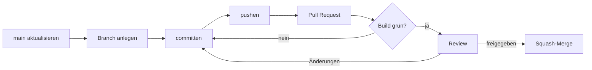
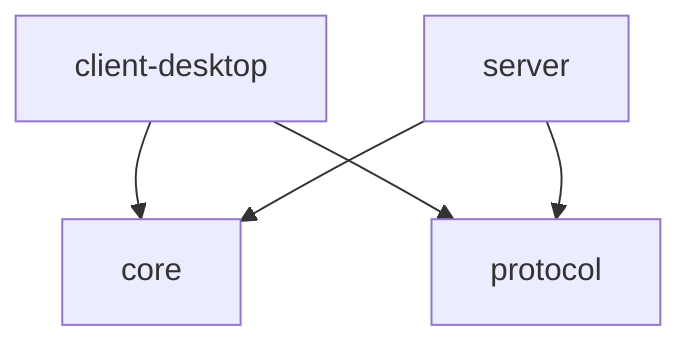

# Betriebshandbuch: Repository, Build und Auslieferung

Dieses Dokument beschreibt, **wie** Repository, Build und Auslieferung des
Projekts eingerichtet sind, einschließlich allem, was nur in
Weboberflächen geklickt wurde und deshalb im Code nicht sichtbar ist.

**Warum** etwas so entschieden wurde, steht in den
[Architekturentscheidungen (ADRs)](adr/README.md). Dieses Handbuch verweist
an den passenden Stellen darauf.

Verantwortlich: Technikverantwortung / DevOps (Manuel Junker).
Jede Änderung an Repository, Build oder Pipeline wird im selben Pull Request
hier nachgetragen, Abschnitt 8 hält sie chronologisch fest.

## Inhalt

1. [GitHub-Organisation und Rechte](#1-github-organisation-und-rechte)
2. [Repository-Einstellungen](#2-repository-einstellungen)
3. [Arbeitsablauf](#3-arbeitsablauf)
4. [Build](#4-build)
5. [Pipeline](#5-pipeline)
6. [Branch-Schutz](#6-branch-schutz)
7. [Releases und Tags](#7-releases-und-tags)
8. [Änderungsprotokoll](#8-änderungsprotokoll)

## 1. GitHub-Organisation und Rechte

| Was | Einstellung |
|---|---|
| Organisation | `mci-dibse-labyrinth-ws26` (kostenloser Plan) |
| Repository | `labyrinth`, **öffentlich** |
| Owner | Technikverantwortung |
| Team `entwickler` | alle Gruppenmitglieder, Recht **Write** auf `labyrinth` |
| Third-party access | eingeschränkt; freigegeben ist die JetBrains-App (IntelliJ) |
| GitHub-Apps | „GitHub for Atlassian“ (Jira), Zugriff nur auf `labyrinth` (Abschnitt 3.1) |

**Warum eine Organisation?** Das Repository gehört nicht einer Person. Rechte
werden einmal über das Team vergeben statt pro Person.

**Warum öffentlich?** Im kostenlosen Plan gibt es Branch-Schutz und
`CODEOWNERS` für Organisationen nur bei öffentlichen Repositories. Daraus folgt eine harte Regel: **Niemals Zugangsdaten
committen.**

**Third-party access:** Die Organisation blockiert fremde OAuth-Apps, bis ein
Owner sie freigibt. Ohne Freigabe scheitert der erste Push aus IntelliJ mit
`403`. Freigegeben unter *Organization Settings → Third-party access → OAuth
application policy*. Wer eine andere App nutzt, schickt beim ersten Zugriff
automatisch eine Anfrage, die dort bestätigt wird.

## 2. Repository-Einstellungen

Unter *Settings → General* des Repositories:

| Einstellung | Wert | Grund |
|---|---|---|
| Issues | **aus** | Einziger Tracker ist Jira; zwei Tracker laufen auseinander |
| Allow merge commits | aus | |
| Allow squash merging | **an** | Ein Commit pro abgeschlossener Aufgabe auf `main` |
| Default commit message (Squash) | „Pull request title and commit details“ | Der PR-Titel wird zur Commit-Nachricht auf `main` |
| Allow rebase merging | aus | |
| Automatically delete head branches | **an** | Keine Sammlung toter Branches |

Dazu kommen Dateien im Repository, die für alle gleich gelten:

| Datei | Zweck |
|---|---|
| `.gitignore` | Build-Ergebnisse, IDE-Ordner, Spielprotokolle (`logs/`) und lokale Konfiguration (`server.properties`) bleiben draußen |
| `.gitattributes` | Zeilenenden: LF im Repository, CRLF nur für Windows-Skripte (`*.bat`) |
| `.editorconfig` | UTF-8, LF, 4 Leerzeichen (Markdown/YAML/JSON: 2), unabhängig von der IDE |
| `.github/pull_request_template.md` | Vorlage für jeden Pull Request: Was, Warum, Jira, Checkliste nach der Definition of Done |

## 3. Arbeitsablauf

Der vollständige Ablauf steht in [`CONTRIBUTING.md`](../CONTRIBUTING.md), die
Einrichtung eines Rechners in
[`entwicklungsumgebung.md`](entwicklungsumgebung.md). Kurzfassung:



- Branch-Namen: `<typ>/<JIRA-KEY>-<kurzbeschreibung>`
- Commit-Nachrichten und **PR-Titel**: `<typ>(<JIRA-KEY>): <beschreibung>`,
  englisch (Conventional Commits). Der PR-Titel wird beim Squash-Merge zum
  einzigen Commit auf `main`.
- Doku wird im selben Pull Request angepasst wie der Code.

### 3.1 Jira-Anbindung

Aufgaben liegen in Jira, Code in GitHub. Verknüpft sind beide über die App
**„GitHub for Atlassian“** ([ADR 0006](adr/0006-jira-ueber-ticket-key-verknuepfen.md)).

| Was | Wert |
|---|---|
| Jira-Projekt-Key | **`AIP6`** (Tickets `AIP6-1`, `AIP6-2`, …) |
| Verbindung | App „GitHub for Atlassian“ in Jira, Organisation `mci-dibse-labyrinth-ws26` |
| Repository-Zugriff der App | nur `labyrinth` („Only select repositories“) |
| Smart Commits | **nicht genutzt** |
| Eingerichtet | 25.10.2026 |

**So funktioniert die Verknüpfung:** Steht ein Ticket-Key im Branch-Namen, in
einer Commit-Nachricht oder im PR-Titel, zeigt Jira Branch, Commit und Pull
Request im Ticket rechts unter **„Development“**. Der Key muss genau so
geschrieben sein wie in Jira: Großbuchstaben, Bindestrich, Nummer.

**Smart Commits** (Tickets per Commit-Nachricht verschieben oder kommentieren)
nutzen wir nicht. Den Status eines Tickets ändert man in Jira.

**Wer kann die Verbindung ändern?** Dafür braucht es beide Seiten: Admin-Rechte
in Jira und Owner-Rechte in der GitHub-Organisation. Die Einstellungen der App
auf GitHub-Seite liegen unter *Organization Settings → GitHub Apps → GitHub for
Atlassian → Configure*.

**Wenn im Ticket nichts erscheint:** Key prüfen (Schreibweise), ein paar
Minuten warten, in Jira unter *Apps → GitHub* nachsehen, ob die Synchronisierung
noch läuft.

## 4. Build

### 4.1 Überblick

| Was | Wert |
|---|---|
| Build-Werkzeug | Gradle **9.8.0**, über den Wrapper ([ADR 0003](adr/0003-gradle-als-build-werkzeug.md)) |
| Build-Skripte | Kotlin-DSL (`*.gradle.kts`) |
| Projektversion | **0.1.0** nach Semantic Versioning, in `gradle.properties` (4.6) |
| Java | **21**, über die Gradle-Toolchain ([ADR 0004](adr/0004-jdk-21-temurin.md)) |
| Tests | JUnit **6** (Jupiter) |
| Javadoc | Pflicht für öffentliche Klassen und Methoden, geprüft bei jedem `build` (4.9) |
| Oberfläche | JavaFX **21**, in Server und Client |
| Struktur | ein Repository, vier Module ([ADR 0002](adr/0002-ein-repository-mit-modulen.md), [ADR 0005](adr/0005-kein-eigener-verzeichnisserver.md)) |

Kernidee: **Niemand muss Gradle oder ein bestimmtes Java installieren**, und
alle bauen trotzdem mit denselben Versionen, lokal wie in der Pipeline.

### 4.2 Verzeichnisstruktur

```
labyrinth/
├── settings.gradle.kts             Projektname, Module, Repositories, JDK-Download
├── gradle.properties               Projektversion
├── gradlew, gradlew.bat            Wrapper-Startskripte (macOS/Linux, Windows)
├── gradle/
│   ├── libs.versions.toml          Versionskatalog: alle Versionen an einer Stelle
│   └── wrapper/                    Wrapper-Programm und Gradle-Version
├── buildSrc/                       gemeinsame Build-Logik
│   ├── build.gradle.kts
│   ├── settings.gradle.kts         macht den Versionskatalog in buildSrc verfügbar
│   └── src/main/kotlin/
│       └── labyrinth.java-conventions.gradle.kts
├── protocol/   core/   server/   client-desktop/
│   ├── build.gradle.kts            je Modul: was es ist und was es benutzt
│   └── src/main/java, src/test/java
└── docs/
```

### 4.3 Gradle Wrapper

Der Wrapper besteht aus `gradlew`, `gradlew.bat` und `gradle/wrapper/`. In
`gradle/wrapper/gradle-wrapper.properties` steht die Gradle-Version. Beim
ersten Aufruf lädt der Wrapper genau diese Version herunter und legt sie im
Benutzerordner ab (`~/.gradle/wrapper/dists`).

Besonderheiten:

- `gradle-wrapper.jar` ist die einzige `.jar`-Datei im Repository. Die
  `.gitignore` nimmt sie mit `!gradle/wrapper/gradle-wrapper.jar` ausdrücklich
  aus.
- `gradlew` ist in Git als **ausführbar** gespeichert (Dateimodus `100755`),
  sonst könnten macOS- und Linux-Nutzer es nicht starten. Windows kennt dieses
  Merkmal nicht; gesetzt wurde es mit `git add --chmod=+x gradlew`.
- `.gitattributes` sorgt dafür, dass `gradlew` LF- und `gradlew.bat`
  CRLF-Zeilenenden behält.

Der Wrapper wurde einmalig mit einer heruntergeladenen Gradle-Distribution
erzeugt (`gradle wrapper`). Seitdem ist keine Gradle-Installation mehr nötig.

### 4.4 Module und Abhängigkeiten



| Modul | Art | Inhalt |
|---|---|---|
| `protocol` | Bibliothek | Nachrichtenklassen und JSON-Serialisierung |
| `core` | Bibliothek | Spielmodell und Spielregeln |
| `server` | Anwendung | Spielserver mit JavaFX-Oberfläche, auch ohne Fenster startbar (4.10) |
| `client-desktop` | Anwendung | JavaFX-Client mit KI |

Der **Verzeichnisserver** ist kein Modul: Alle Gruppen nutzen einen gemeinsamen, der außerhalb dieses Repositories entsteht ([ADR 0005](adr/0005-kein-eigener-verzeichnisserver.md)). `server` meldet sich dort an, `client-desktop` holt dort die Serverliste; die dafür nötigen Nachrichten gehören in `protocol`.

Regeln:

- Module werden in `settings.gradle.kts` (Hauptordner) mit `include(...)`
  aufgenommen.
- Eine Abhängigkeit zwischen Modulen ist eine Zeile in der `build.gradle.kts`
  des benutzenden Moduls: `implementation(project(":core"))`. Was dort nicht
  steht, kann ein Modul nicht benutzen; der Compiler meldet einen Fehler.
- `core` und `protocol` hängen bewusst **nicht** voneinander ab. Das Protokoll
  wird gruppenübergreifend abgestimmt (Lastenheft, Abschnitt 5) und soll nicht
  an internen Klassen hängen. Server und Client übersetzen zwischen beiden.
- `client-desktop` kennt `server` nicht und umgekehrt.
- Anwendungen haben das Gradle-Plugin `application` und damit die Aufgabe
  `run`. Die Startklasse steht in `application { mainClass = ... }`.
- Paketnamen: `edu.mci.labyrinth.<modul>` (abgeleitet von der Domain
  `mci.edu`).

### 4.5 Gemeinsame Konfiguration (Konventions-Plugin)

Was für alle Java-Module gleich ist, steht einmal in
`buildSrc/src/main/kotlin/labyrinth.java-conventions.gradle.kts`:

```kotlin
plugins {
    java
}

val libs = extensions.getByType<VersionCatalogsExtension>().named("libs")

java {
    toolchain {
        languageVersion = JavaLanguageVersion.of(21)
    }
}

testing {
    suites.named<JvmTestSuite>("test") {
        useJUnitJupiter(libs.findVersion("junit").get().requiredVersion)
    }
}
```

Am Ende der Datei steht zusätzlich die Javadoc-Prüfung (Abschnitt 4.9).

Jedes Modul übernimmt das mit einer Zeile:

```kotlin
plugins {
    id("labyrinth.java-conventions")
}
```

`buildSrc` ist ein Sonderordner: Gradle baut ihn vor allem anderen und stellt
die Plugins darin allen Build-Skripten zur Verfügung. Der Dateiname ohne
`.gradle.kts` ist die Plugin-ID.

Hinweis zur Zeile `val libs = ...`: In normalen Build-Skripten heißt der
Versionskatalog einfach `libs`. In Plugins unter `buildSrc` muss man ihn so
anfordern. Damit `buildSrc` den Katalog überhaupt kennt, verweist
`buildSrc/settings.gradle.kts` auf `../gradle/libs.versions.toml`.

### 4.6 Versionskatalog

`gradle/libs.versions.toml` ist die **einzige** Stelle, an der Versionen von
Bibliotheken und Plugins stehen:

| Eintrag | Version | Wofür |
|---|---|---|
| `junit` | 6.1.3 | Tests |
| `javafx` | 21.0.12 | Oberfläche von Server und Client |
| Plugin `org.openjfx.javafxplugin` | 0.1.0 | bindet JavaFX passend zum Betriebssystem ein |

Zusätzlich, außerhalb des Katalogs:

| Was | Version | Wo |
|---|---|---|
| Gradle | 9.8.0 | `gradle/wrapper/gradle-wrapper.properties` |
| Plugin `foojay-resolver-convention` | 1.0.0 | `settings.gradle.kts` (Settings-Plugins können den Katalog nicht nutzen) |
| Projektversion | 0.1.0 | `gradle.properties` |

**Projektversion:** `version=0.1.0` in `gradle.properties` gilt für alle
Module und folgt Semantic Versioning (Pflichtenheft 12.4). Sie steht in den
Dateinamen der Pakete (`server-0.1.0.zip`) und wird später als
`serverVersion` in `SERVER_INFO` gemeldet (A-46). Wann sie erhöht wird, legt
Abschnitt 7 fest (geplant).

### 4.7 Java-Version und Toolchain

Zwei verschiedene Java-Rollen:

1. **Gradle selbst** läuft auf irgendeinem JDK ab Version 17. In IntelliJ ist
   das die „Gradle JVM“ (Settings → Build Tools → Gradle), im Terminal das JDK
   aus `JAVA_HOME`.
2. **Kompiliert, getestet und gestartet** wird immer mit Java 21. Das legt die
   **Toolchain** im Konventions-Plugin fest, unabhängig davon, womit Gradle
   selbst läuft.

Woher kommt das JDK 21 für die Toolchain? Gradle sucht in dieser Reihenfolge:

1. bereits installierte JDKs (übliche Installationsorte, `JAVA_HOME`, von
   IntelliJ heruntergeladene JDKs in `~/.jdks`)
2. falls keines passt: automatischer Download über den Dienst **foojay**
   (Plugin `foojay-resolver-convention` in `settings.gradle.kts`) nach
   `~/.gradle/jdks`

Beobachtung beim Test auf einem frischen Laptop (08.10.2026): IntelliJ fragt
beim ersten Laden nach einem JDK, um Gradle zu starten. Mit **21 / Eclipse
Temurin** findet Gradle dasselbe JDK auch für die Toolchain; ein zweiter
Download entfällt. Deshalb empfiehlt die Einrichtungsanleitung genau diese
Auswahl.

### 4.8 Tests

- JUnit 6 (Jupiter-API: `@Test`, `assertEquals` …), eingebunden über
  `useJUnitJupiter(...)` im Konventions-Plugin. Gradle fügt die nötigen
  Bibliotheken selbst hinzu.
- Tests liegen in `src/test/java`, im selben Paket wie die getestete Klasse.
- Tests zu einer Anforderung tragen ihre Kennung, z. B. `@Tag("F-237")`
  (Pflichtenheft 12.4, Regeln in [`CONTRIBUTING.md`](../CONTRIBUTING.md)).
- `build` führt alle Tests aus; Testberichte liegen danach unter
  `<modul>/build/reports/tests/test/index.html`.

### 4.9 Javadoc-Prüfung

Das Pflichtenheft verlangt Javadoc für alle öffentlichen Klassen und Methoden,
nachgewiesen in der Pipeline (NF-09). Umgesetzt am Ende des
Konventions-Plugins:

```kotlin
tasks.javadoc {
    val javadocOptions = options as StandardJavadocDocletOptions
    javadocOptions.addBooleanOption("Xdoclint:all", true)
    javadocOptions.addBooleanOption("Werror", true)
}

tasks.check {
    dependsOn(tasks.javadoc)
}
```

- `-Xdoclint:all`: javadoc prüft fehlende Kommentare, fehlende `@param` und
  `@return`, fehlerhaftes HTML und ungültige Verweise.
- `-Werror`: Jede Warnung lässt die Aufgabe `javadoc` scheitern.
- `check` hängt von `javadoc` ab. Damit führen `build` und die Pipeline die
  Prüfung aus; `test` allein nicht.

Geprüft wird nur der Hauptcode (`src/main/java`), und dort nur öffentliche und
geschützte Klassen und Methoden. Methoden mit `@Override` erben die
Beschreibung. Ob die Javadoc englisch ist (NF-13), prüft der Build nicht; das
gehört ins Review. Regeln für das Team: [`CONTRIBUTING.md`](../CONTRIBUTING.md).

Eine Meldung sieht so aus (lokal in der Sprache des installierten Java):

```
ServerApp.java:17: warning: no comment
error: warnings found and -Werror specified
```

Die erzeugte Dokumentation liegt unter
`<modul>/build/docs/javadoc/index.html`.

### 4.10 JavaFX

JavaFX ist seit Java 11 nicht mehr im JDK enthalten. Das Plugin
`org.openjfx.javafxplugin` lädt die passende Variante für das jeweilige
Betriebssystem (Windows, macOS Intel/Apple Silicon, Linux) und sorgt dafür,
dass `run` die Anwendung korrekt startet. Server und Client binden es gleich
ein, in `server/build.gradle.kts` und `client-desktop/build.gradle.kts`:

```kotlin
javafx {
    version = libs.versions.javafx.get()
    modules("javafx.controls")
}
```

Weitere JavaFX-Module (z. B. `javafx.fxml`) werden in der `build.gradle.kts`
des jeweiligen Moduls ergänzt.

Version 21: JavaFX 25 und neuer benötigen ein neueres JDK als 21.

**Server mit und ohne Fenster:** Startklasse des Servers ist `ServerApp`.
Ohne Parameter öffnet sie das Fenster `ServerWindow` (Pflichtenheft M-01).
Mit `--headless` läuft der Server ohne Fenster (S-04, F-237); JavaFX wird
dabei gar nicht gestartet. Das braucht man auf Rechnern ohne Bildschirm,
etwa für Integrationstests.

### 4.11 Wichtige Befehle

| Befehl (Windows; macOS/Linux: `./gradlew`) | Wirkung |
|---|---|
| `.\gradlew.bat build` | alles kompilieren, testen, Javadoc prüfen, paketieren |
| `.\gradlew.bat build --continue` | wie `build`, zeigt aber die Fehler aller Module auf einmal |
| `.\gradlew.bat test` | nur Tests |
| `.\gradlew.bat javadoc` | nur Javadoc erzeugen und prüfen |
| `.\gradlew.bat :server:run` | Spielserver mit Fenster starten |
| `.\gradlew.bat :server:run --args="--headless"` | Spielserver ohne Fenster starten |
| `.\gradlew.bat :client-desktop:run` | Desktop-Client starten |
| `.\gradlew.bat clean` | Build-Ergebnisse löschen |
| `.\gradlew.bat build --warning-mode all` | Build mit allen Hinweisen auf veraltete Funktionen |

**Neue Bibliothek einbinden** (Beispiel, Namen und Version anpassen):

```toml
# gradle/libs.versions.toml
[versions]
gson = "x.y.z"

[libraries]
gson = { module = "com.google.code.gson:gson", version.ref = "gson" }
```

```kotlin
// <modul>/build.gradle.kts
dependencies {
    implementation(libs.gson)
}
```

**Neues Modul anlegen:** Ordner mit `build.gradle.kts` anlegen
(`plugins { id("labyrinth.java-conventions") }`), in `settings.gradle.kts`
unter `include(...)` ergänzen, Gradle in IntelliJ neu laden.

**Gradle aktualisieren:**

```powershell
.\gradlew.bat wrapper --gradle-version <neue-version>
```

Danach einmal bauen und alle geänderten Dateien unter `gradle/wrapper/` sowie
`gradlew`, `gradlew.bat` committen.

### 4.12 Bekannte Probleme

| Problem | Auswirkung | Umgang |
|---|---|---|
| Das JavaFX-Plugin 0.1.0 (letzte Version, September 2023) nutzt beim Start von Server und Client eine veraltete Gradle-Funktion („Invocation of Task.extensions at execution time“). Gradle meldet: „Deprecated Gradle features were used …, making it incompatible with Gradle 10.“ | Nur `:server:run` und `:client-desktop:run`. Build und Tests sind nicht betroffen. Funktioniert bis einschließlich Gradle 9. | Beobachten. Vor einem Wechsel auf Gradle 10 prüfen, ob es eine neue Plugin-Version gibt; sonst JavaFX ohne Plugin einbinden. |
| Gradle empfiehlt bei jedem Build den „Configuration Cache“. | keine | Später prüfen und ggf. aktivieren. |

## 5. Pipeline

GitHub Actions baut und testet das Projekt automatisch auf einem frischen
Linux-Rechner ([ADR 0007](adr/0007-ci-mit-github-actions.md)). Damit läuft der
Build regelmäßig auf drei Betriebssystemen: Windows und macOS im Team, Linux in
der Pipeline.

### 5.1 Überblick

| Was | Wert |
|---|---|
| Datei | `.github/workflows/build.yml` |
| Dienst | GitHub Actions mit von GitHub bereitgestellten Rechnern (für öffentliche Repositories kostenlos) |
| Rechner | `ubuntu-latest`, für jeden Lauf neu aufgesetzt und danach gelöscht |
| Java | 21, Eclipse Temurin ([ADR 0004](adr/0004-jdk-21-temurin.md)) |
| Befehl | `./gradlew build`: kompilieren, alle Tests, Javadoc prüfen, paketieren |
| Name der Prüfung | `build` (wird im Branch-Schutz die Pflicht-Prüfung, Abschnitt 6) |
| Zeitlimit | 15 Minuten |
| Eingerichtet | 26.10.2026 |

### 5.2 Wann sie läuft

| Auslöser | Wann |
|---|---|
| `pull_request` | beim Öffnen eines Pull Requests und bei jedem weiteren Push auf dessen Branch |
| `push` auf `main` | nach jedem Merge, und bei direkten Pushes, solange `main` nicht geschützt ist |
| `workflow_dispatch` | von Hand: Tab *Actions* → *Build* → *Run workflow* |

Bei einem Pull Request baut die Pipeline nicht den Branch allein, sondern das
Ergebnis nach dem Merge: Branch plus aktueller Stand von `main`. Grün heißt
also: So, wie es jetzt ist, würde `main` nach dem Merge bauen.

Branches ohne Pull Request baut die Pipeline nicht. Sie können `main` nicht
erreichen, und so wird jede Änderung genau einmal gebaut statt doppelt.

**Tipp:** Wer früh Rückmeldung will, öffnet den Pull Request gleich als
Entwurf (*Create draft pull request*). Die Pipeline läuft dann bei jedem Push;
um ein Review wird erst mit *Ready for review* gebeten.

### 5.3 Ablauf

| Schritt | Was passiert |
|---|---|
| Code auschecken | `actions/checkout` holt den zu prüfenden Stand |
| Java 21 (Temurin) einrichten | `actions/setup-java` installiert das JDK. Gradle findet es auch für die Toolchain, ein Download über foojay entfällt |
| Gradle einrichten | `gradle/actions/setup-gradle` stellt den Cache wieder her (5.4) und prüft den Gradle Wrapper (5.5) |
| Bauen und testen | `./gradlew build`, derselbe Befehl wie lokal |

Lokal gilt weiterhin: **Vor jedem Commit muss der lokale Build grün sein**
([`CONTRIBUTING.md`](../CONTRIBUTING.md)). Die Pipeline ist die zweite
Sicherung, nicht die erste.

### 5.4 Cache

`setup-gradle` speichert die Gradle-Distribution und heruntergeladene
Bibliotheken zwischen den Läufen im Cache von GitHub Actions. Eingestellt ist
`cache-provider: basic`, die quelloffene Variante (MIT-Lizenz). Die
Standardvariante „enhanced“ ist eine proprietäre Komponente von Gradle mit
eigenen Nutzungsbedingungen ([ADR 0007](adr/0007-ci-mit-github-actions.md)).

- In den Cache schreiben nur Läufe auf `main`. Pull Requests lesen ihn nur.
- Der Schlüssel ergibt sich aus den Build-Dateien (`*.gradle.kts`,
  `gradle-wrapper.properties`, `libs.versions.toml`). Ändert sich eine davon,
  startet der nächste Lauf ohne Cache und lädt alles einmal neu.

### 5.5 Sicherheit

- **Rechte:** `permissions: contents: read`. Das automatische Zugangs-Token der
  Pipeline darf das Repository nur lesen.
- **Wrapper-Prüfung:** `setup-gradle` vergleicht `gradle-wrapper.jar` mit den
  offiziellen Prüfsummen von Gradle. Eine veränderte Datei lässt den Lauf
  scheitern, bevor der Build startet.
- **Keine Geheimnisse:** Die Pipeline braucht keine Zugangsdaten, es sind keine
  *Secrets* hinterlegt.

### 5.6 Wenn die Pipeline rot ist

1. Im Pull Request bei den Prüfungen auf **Details** klicken. Der
   fehlgeschlagene Schritt ist aufgeklappt, die Fehlermeldung steht meist am
   Ende.
2. Den Fehler lokal nachstellen: `.\gradlew.bat build`. Häufigste Ursachen
   sind Kompilierfehler, fehlgeschlagene Tests und fehlende Javadoc.
3. Korrigieren, committen, pushen. Die Pipeline läuft automatisch erneut.
4. Baut es lokal, aber nicht in der Pipeline, liegt es meist am
   Betriebssystem: Groß- und Kleinschreibung in Dateinamen (Linux
   unterscheidet sie, Windows nicht), Pfadtrenner, Zeilenenden. Bei einem
   vermutlich zufälligen Fehler hilft **Re-run jobs**.

### 5.7 Wartung

| Action | Version | Zweck |
|---|---|---|
| `actions/checkout` | v7 | Code holen |
| `actions/setup-java` | v5 | JDK installieren |
| `gradle/actions/setup-gradle` | v6 | Cache, Wrapper-Prüfung, Zusammenfassung des Laufs |

- Die Actions sind über ihre Hauptversion eingebunden (`@v7`). Fehlerkorrekturen
  kommen damit automatisch, brechende Änderungen nicht. Eine neue
  Hauptversion wird von Hand eingetragen und in Abschnitt 8 vermerkt.
- Der Job heißt `build`. Unter diesem Namen wird er die Pflicht-Prüfung im
  Branch-Schutz; wer ihn umbenennt, muss den Branch-Schutz anpassen.

### 5.8 Geplante Erweiterungen

- Testberichte und Testabdeckung (JaCoCo) als Ergebnis jedes Laufs, zusammen
  mit dem Testplan.
- Pipeline als Pflicht-Prüfung im Branch-Schutz (Abschnitt 6).
- Releases bei Abgabe-Tags (Abschnitt 7).

## 6. Branch-Schutz

*Geplant*, nachdem alle das Projekt einmal gebaut und einen ersten Pull Request
durchgespielt haben. Vorgesehen für `main`: Änderungen nur per Pull Request,
mindestens eine Freigabe, Pipeline muss grün sein. Zuständigkeiten pro Ordner
über `.github/CODEOWNERS` (`protocol/` → Schnittstellenvertretung, `docs/` →
Qualitätsmanagement).

Bewusst zuletzt: Solange nur eine Person am Repository arbeitet, würde die
Review-Pflicht sie selbst blockieren.

## 7. Releases und Tags

*Geplant.* Zu jeder Abgabe wird der abgegebene Stand auf `main` mit einem
Git-Tag markiert, damit jederzeit nachvollziehbar ist, was abgegeben wurde.

| Datum | Abgabe |
|---|---|
| 25.10.2026 | Pflichtenheft |
| 22.11.2026 | Testplan und Unit Tests |
| 16.12.2026 | Zwischenpräsentation |
| 24.01.2027 | Finale Abgabe |

## 8. Änderungsprotokoll

| Datum | Änderung | Wo |
|---|---|---|
| 24.09.2026 | Organisation, Team `entwickler`, Repository angelegt; `.gitignore`, `.gitattributes`, `.editorconfig`, `README.md`, `CONTRIBUTING.md` | Commits vor PR #1 |
| 24.09.2026 | Repository-Einstellungen (Abschnitt 2) gesetzt; JetBrains-App freigegeben | GitHub-Oberfläche |
| 24.09.2026 | PR-Vorlage; PR-Titel im Commit-Format | PR #1 |
| 30.09.2026 | Gruppenbeschluss: ein Repository mit Modulen, Gradle, JDK 21 | Besprechung, ADR 0002–0004 |
| 08.10.2026 | Gradle-Grundgerüst: Wrapper 9.8.0, fünf Module, Konventions-Plugin, Versionskatalog, Toolchain Java 21, JUnit 6, JavaFX 21; Einrichtungsanleitung, dieses Handbuch, ADRs 0001–0004 | Branch `chore/gradle-grundgeruest` |
| 08.10.2026 | README: Schnellstart, Befehle, Abschnitt Mitarbeiten | direkt auf main |
| 11.10.2026 | Modul `directory-server` entfernt; gemeinsamer Verzeichnisserver für alle Gruppen (ADR 0005) | direkt auf main |
| 25.10.2026 | Jira über „GitHub for Atlassian“ angebunden, Projekt-Key `AIP6`, keine Smart Commits (Abschnitt 3.1, ADR 0006); Platzhalter `LAB` in `CONTRIBUTING.md` und PR-Vorlage ersetzt | Jira-/GitHub-Oberfläche, Branches `AIP6-9-JIRA-TEST` (Test) und `docs/AIP6-9-jira-doku` |
| 26.10.2026 | CI-Pipeline mit GitHub Actions: Build und Tests bei jedem Pull Request und jedem Push auf `main`, Java 21 (Temurin), Gradle-Cache „basic“, Wrapper-Prüfung (Abschnitt 5, ADR 0007) | Branch `chore/AIP6-7-ci-pipeline` |
| 28.10.2026 | Angleichung an Pflichtenheft v1.2: Projektversion 0.1.0 in `gradle.properties`; JavaFX und Serverfenster im Server, Start ohne Fenster mit `--headless`; Javadoc-Prüfung im Build, Javadoc englisch; `.gitignore` um `logs/` und `server.properties`; Regeln für Javadoc und Anforderungs-IDs in `CONTRIBUTING.md`; PR-Vorlage mit Definition of Done (Abschnitt 4) | Branch `chore/AIP6-18-align-pflichtenheft` |

